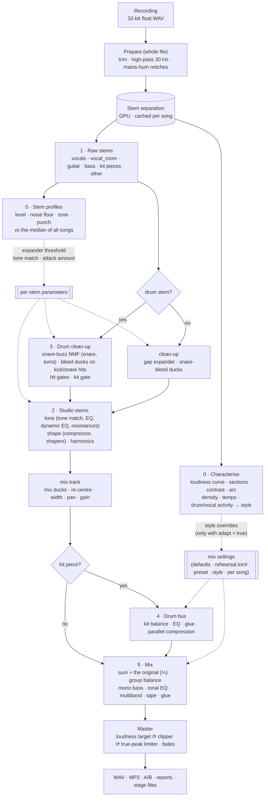
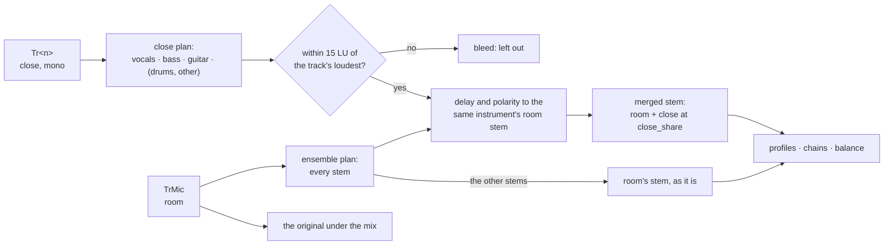
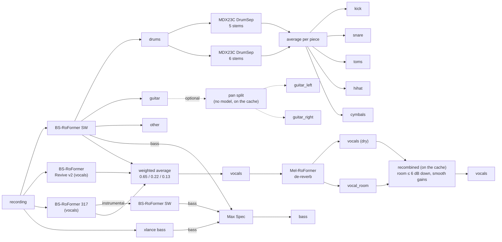
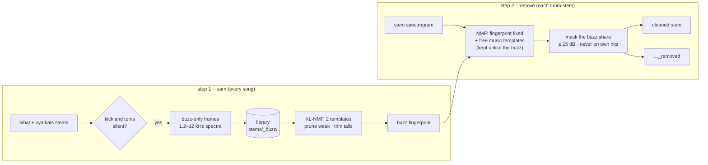
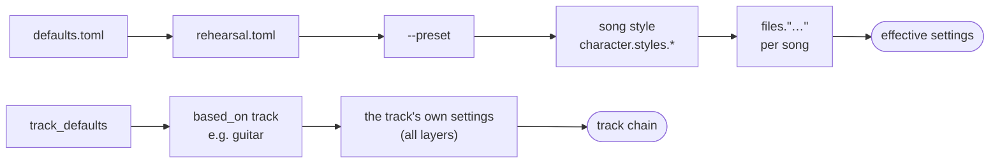

# rehearsal-master: design

How the pipeline turns a stereo rehearsal recording (one recorder in the room) into a
balanced, mastered track, and why it is built the way it is. For using it, see the
[README](../README.md); every setting is documented in
[defaults.toml](../rehearsal_master/defaults.toml).

This describes the pipeline as it runs today. The planned simplification (fewer stages, the
original recording blended in, quieter samples) is in [PLAN.md](PLAN.md).

## 1. Principles

- **Measure, then act.** Every adaptive step is driven by a measurement of the song itself
  (loudness, spectrum, hits, hum, stereo positions, buzz, each stem's profile), not by fixed
  assumptions.
- **Nothing is lost.** Stems sum back to the recording, and the recording itself is blended
  under the processed stems (a quarter of the loudness by default, a tenth in the band's
  `rehearsal.toml`, `[mix] original_share`): what the
  separation and the clean-up take out is still there, at a known level. Masks and band splits
  are built to reconstruct exactly.
- **Each stage is audible.** Stages 0–5 are written to disk, so every decision can be heard
  and checked in isolation.
- **Consistent across songs.** Instrument levels and tones are pulled towards targets learnt
  from the band's own songs, so one song's vocals do not sit 8 dB above another's and a picked
  bass does not sound unlike a fingered one.
- **Offline, so look-ahead is free.** Zero-phase and linear-phase filters, look-ahead
  detectors and two-pass analysis are used wherever they sound better than real-time ones.
- **Bounded memory.** Long operations work in chunks; separation runs in a subprocess; the
  whole run sits in a memory-capped systemd scope (4 GB), so the desktop is never at risk.

## 2. Pipeline



The drum clean-up (3) runs before the studio chain (2) of the drum stems: compression and
EQ would otherwise raise the very buzz the clean-up removes. The numbering follows the
listening stages.

## 3. Stages

### Before the stages: trim, rumble, hum, separation

- **Trim** finds the first and last *sustained* sound (50 ms windows above loudness −30 LU,
  lasting ≥ 1 s, so record-button clicks are ignored) and keeps a 2 s lead-in with a 1.5 s
  fade-in.
- **High-pass** 4th-order at 30 Hz (a bass guitar's low E is 41 Hz).
- **Mains hum**: harmonics of exactly 50 Hz (or 60 Hz) that stand ≥ 10 dB above their
  surroundings in the silent lead-in (fallback: moments ≥ 30 dB below the music; none: no
  removal) are notched with zero-phase notches about 1–1.5 Hz wide. Music is never at exact
  mains multiples for long, so notes are not mistaken for hum.
- **Separation** runs on the *whole* recording (so a new trim never needs a new separation)
  and is cached per song with a key of file, filters and the model steps (not the pan split,
  which runs on the cached stems).

### Stage 0: characterisation ([character.py](../rehearsal_master/character.py))

| metric | from | meaning |
|---|---|---|
| integrated loudness, LRA | BS.1770 / EBU 3342 | overall level, loudness range |
| contrast | P90 − P10 of short-term loudness | quiet vs loud parts |
| arc, slope | last third − first third; linear fit (LU/min) | does it build up? |
| sections | ≥ 3 LU steps of the 5 s-smoothed loudness | song structure |
| onset rate, tempo | spectral flux peaks; its autocorrelation | density, BPM |
| drums playing | kit hits with a 2 s hold | share of the song with drums |
| vocals singing | vocal stem activity | share of the song with voice |
| guitar flatness | spectral flatness 1–6 kHz | distortion (≈1 = noise-like) |

Rules, in order: **ballad** (drums < 50 % or slow and sparse) · **build** (arc ≥ 4 LU and
rising) · **dynamic** (contrast ≥ 7 LU) · **wall** (contrast ≤ 5 LU, drums ≥ 85 %, dense or
distorted) · **steady**. Each style has an override table (`[character.styles.<style>]`)
merged into the mix settings when `character.adapt` is on (off since November 2026: one
chain for every song, so the songs sound alike; the style is still measured and reported), e.g. *wall* adds glue, tape and drum parallel compression;
*ballad* relaxes compression and brings the voice forward; *build* keeps the glue from
flattening the rise. Overrides change amounts, not on/off switches, so a preset that
disables a stage keeps it disabled.

**Stem profiles** ([profile.py](../rehearsal_master/profile.py)). Before any clean-up, every
raw stem is measured on the whole cached stem, in 85 ms frames, only while the band plays
(the stems' sum within 25 dB of its loud level, so talk between songs does not count):

| metric | from | used for |
|---|---|---|
| level, floor, SNR | P90 of the frames where it plays; P5 of all frames | expander threshold (`expander.adapt`) |
| active | share of the playing time within 20 dB of its level | report |
| tone | average 1/3-octave spectrum while it plays, relative to its own level | tone match |
| hf/lf | 2–8 kHz against 60–250 Hz | report (pick vs fingers, open hats) |
| punch | P95 of the onset rise (fast/slow envelope, as the transient shaper sees it) | attack amount (`transient.adapt`) |
| kick-locked | its level on kick hits against its average | report (kick bleed, or playing with it) |

Each song's profiles are kept next to its stems (`_profile.json`). The **target** for an
instrument is the median over all songs with cached stems, so the corrections pull each stem
towards how that instrument usually sounds in this band. The profiles are written to
`character.json` and the report JSON.

### Close tracks ([takes.py](../rehearsal_master/takes.py), [multitrack.py](../rehearsal_master/multitrack.py))

A take may hold more than the room. On a Zoom with inputs: `TrMic`, the built-in stereo mic;
`Tr<n>`, each input; and `TrLR`, the recorder's own mix-down, measured as exactly 1.413 `TrMic` +
1.000 `Tr2` (residual −149 dB, all 8 takes of 5 November 2026). So the room is `TrMic`: separating
`TrLR` would put the close track in every room stem, and then in the mix twice. Without a `TrMic`,
`TrLR` is the stereo pair itself.



- **What a track holds**: the band's `Tr2` is a mixer feed. Over the 8 takes, against the track: voice
  −2.5 to +0.7 LU, bass −6.2 to −1.4, drums −32 to −17. Guitar is 19 to 25 LU under the track's
  loudest stem, never above bleed. `other` is −7 and −2 LU on the two takes where it plays (Miramare
  and the full Stanza: a mid-range instrument, 15–19 % of the take, on the voice's path) and silent
  elsewhere. A stem more than `min_level_lu` under its track's loudest is bleed. When
  several tracks hold an instrument, those within `keep_within_db` of where it stands strongest
  stay, so two guitars on two inputs are both used, and a vocal mic's bleed of the bass amp is not.
  A mono track cannot be split by position, so two guitars on one feed are one stem.
- **Lining up**: the room hears a feed through an amp or a PA, several metres later and sometimes
  the other way up. Phase-only cross-correlation of the two stems over the whole take gives the
  delay and polarity, in the band where the instrument is (`align_band_hz`), and the windows where
  the stem plays say how steady that is. Over the 8 takes the voice is 9.6 to 11.5 ms later and
  always inverted, the bass 11 ms later, 16 ms on one take, and never inverted. In every band from
  50 Hz to 6.4 kHz the lined-up sum stays within ±2.2 dB of the two parts' summed powers. The steady
  share can be low (the bass 0 % and 25 % on the two Stanza takes, the voice 58 % on one Biancaneve)
  because a window finds a reflection rather than the direct sound. That is not a wrong delay: on the
  take with 16 ms, 16 ms adds up and the usual 11 ms would lose 1.8 dB at 50–100 Hz
  (`experiments/multitrack/delay_candidates.py`). Without the polarity flip the voice would lose up
  to 1.8 dB. No clear peak (`min_peak`): no shift, since an unrelated signal has nothing to cancel.
- **One stem**: the close stem is set against the room's by loudness, `close_share` of the two
  parts, and added to it before the chain: one chain and one fader per instrument, and everything after
  it works as on any stem. The vocal's room is turned down first, as ever. The merged stems have a cache of their
  own, one folder per set of merge settings, so that tone targets are medians of stems like this one.
- **The original** under the mix remains the room alone, and the balance's estimate of the
  original's share of a group uses the room's stems, not the merged ones.
- **Order**: all the takes are separated and merged before the first is processed, so each one's tone
  targets are the same whatever the order.

### Stage 1: raw stems ([separate.py](../rehearsal_master/separate.py))

The *roformer* backend runs one of two **plans** (`stems.plan`), chains of models run
through audio-separator. Each step maps model outputs to stem names (several outputs of a
model may sum into one); a step may run several models on the same input and average each
stem over the models that produce it (`models = [...]`, weights per model and per stem).
Inputs are scaled 12 dB down so audio-separator never rescales a stem, and processed in 60 s
chunks with 5 s crossfades. Each plan keeps its own cache (`processed/stems/` for cascade,
`processed/stems_<plan>/` for the others), so switching back needs no new separation. Every
model's own outputs, before averaging, are kept for listening in `<cache>/<song>/models/`
(`<step>_<input>/<model>/<stem>.flac` and `<step>_<input>/ensemble/`, 24-bit FLAC 12 dB below
the recording, listed in `index.json`; the stage folder's `1_raw/models/`).

- **ensemble** (default), laid out like MVSep's "Ensemble All-In": every first-level model
  reads the whole recording. BS-RoFormer SW gives drums, bass, guitar, other (piano and other)
  and a vocal estimate; the vocals are its estimate averaged with two vocal models
  (SW 0.65, BS-RoFormer Revive v2 0.22, BS-RoFormer 317 0.13). The bass is the **Max Spec**
  (per STFT bin the largest magnitude, UVR's ensemble) of three estimates: xlance's bass
  model, SW's, and SW's on the 317 model's instrumental, which keeps more of the bass's upper
  partials (see below). The kit pieces are the
  average, per piece, of two MDX23C DrumSep models on SW's drums: the newer 5-stem one
  (better on kick and toms) and the 6-stem one (better on snare and hi-hat/cymbals); weights
  kick 0.55/0.45, snare 0.38/0.62, toms 0.61/0.39, hi-hat and cymbals 0.75/0.25
  (5-stem/6-stem; for hi-hat and cymbals from the band's songs, see Hi-hat samples). Then the vocal de-reverb as in cascade.
- **cascade** (the earlier chain, kept as a fallback): vocals vs instrumental (BS-RoFormer
  317) → instrumental into drums/bass/guitar/other (BS-RoFormer SW, its leftover vocals added
  to the vocals) → kit pieces (MDX23C DrumSep, 6 stems) → vocal de-reverb.

Both end with the (optional, off) **pan split** of the guitar stem and the vocal de-reverb
(Mel-RoFormer; the room part becomes `vocal_room`).



**Choosing the models: the rehearsal-room benchmark** ([experiments/sep_bench](../experiments/sep_bench)).
Published scores (MVSep's leaderboards, ZFTurbo's tables) are measured on studio mixes; these
recordings are one X/Y pair in a room. `build.py` makes 12 test songs of 45 s from
Cambridge-MT raw multitracks (RawStems) with drums, bass, electric guitars and vocals: each
close-miked source is placed in a simulated rehearsal room (image sources, RT60 0.4–0.8 s;
kit pieces, two guitar amps, a bass amp, vocals from two PA speakers) and picked up by two
cardioids at 90°, at this band's levels (its learnt group balance and kit-piece levels). The
references are what each source contributes at the recorder, room included. `evaluate.py`
runs every candidate through this module's own code and scores SDR (as MVSep), bleedless and
fullness (ZFTurbo's metrics); ensemble weights maximise the mean SDR and are checked
leave-one-song-out. Mean SDR over the 12 songs (dB):

| stem | cascade | ensemble | notes |
|---|---|---|---|
| vocals | 7.47 | 7.92 | better in 12/12 songs; single models: SW 7.84, Revive v2 7.57, 317 7.47, KJ 7.17, becruily 6.90 |
| guitar | 5.93 | 6.13 | SW on the recording instead of on the vocal model's instrumental |
| bass | 10.58 | 11.20 | Max Spec of xlance's bass (11.01 alone), SW (10.66) and SW on the instrumental (10.58): better than SW in 11/12 songs, and in the two songs where one of them fails (2.7 or 3.5 dB) it keeps the one that does not; 2–4 dB more of the upper partials. htdemucs_ft, beatloo's bass, the 53-stem model and UVR's pitch change (±2 semitones averaged: +0.04 dB) added nothing |
| drums | 11.76 | 11.79 | idem |
| kick | 11.15 | 11.36 | 5-stem alone 11.23, 6-stem 11.15 (on SW's drums) |
| snare | 5.69 | 5.78 | 5-stem alone 5.55: worse here than on MVSep's test set |
| toms | 3.66 | 4.30 | 5-stem alone 4.02 |
| hi-hat + cymbals | 3.37 | 3.40 | |

On the true drums (an "oracle" input) DrumSep reaches kick 13.2, snare 5.8, toms 4.7: the
drums extraction costs about 2 dB on the kick, little on the snare, whose score is limited by
the references (the snare's top octaves and the hi-hat stay in the overheads, which the test
songs use as the cymbals). The hi-hat and the cymbals are scored together for the same reason.
The gains are modest but consistent; MVSep's own ensembles (vocals 11.93 on Multisong) use
models that are not published.

**Vocal recombination** (`[stems.vocal_room]`). Alone, the de-reverbed vocal sounds glitchy:
the model files 25–70 % of the voice's energy as "room" and its dry output jumps from frame
to frame (1.7–3 dB per frame of gain change, against the whole vocal). Its two outputs sum
back to its input, so they are added back together and the room is only turned down,
by at most 6 dB, with gains that follow the model's dry/room split smoothed over 50 ms and
9 STFT bins (≈ 0.25 dB per frame: smoother than the old dry + room at −4 dB). The vocal chain
then sees one natural vocal; its profile is that of the recombined vocal. The Albini preset
keeps the vocal as recorded (no reduction).

The **pan split** (`[stems.pan_split]`) separates the two guitars by where their amps
stood: an energy-weighted histogram of per-bin left/right level difference shows two
clusters (≥ 8 dB apart, with a dip between them); soft time-frequency masks around the
split point make two stems that sum back to the input exactly. One cluster only: one
`guitar` stem. It is off by default: one guitar stem, mostly re-centred and narrowed, gives
a fuller, less divided band sound. It runs on the cached guitar stem, so switching it needs
no new separation; both halves share the guitar's profile and tone match.

### Stage 3: drum clean-up ([cleanup.py](../rehearsal_master/cleanup.py), [effects.py](../rehearsal_master/effects.py))

- **Hit triggers** (0..1 per sample) for kick, snare and toms from their stems, each in the
  band where only that drum lives (the snare on its body, 150–400 Hz, so its own wire buzz is
  never taken for a hit).
- **Snare buzz**, two steps. Since November 2026 it is removed from the snare and tom stems
  only (`[buzz] stems`): on the hi-hat and cymbals, which share its band, the 2–4.5 dB it
  took was heard as artifacts, while on the snare and toms it takes 0.2–0.6 dB (their hit
  gates do most of the work there). The figures below are from when it ran on all four.
  (1) *Learn*: frames of the hi-hat/cymbal stems while kick and
  toms are silent, and not within 300 ms of the stem's own strokes, hold only the snare
  resonating with bass, guitars and voice. Without that last condition, hats played on their
  own were learnt as "buzz", and the removal took 6–8 dB off the hats while they played;
  now it is 3–5 dB, mostly in the buzz's 2–4 kHz. every song adds
  them to a library (`stems/_buzz/`) and a 2-template non-negative matrix factorisation
  (KL-NMF) gives the buzz fingerprint, pruned of templates that explain < 10 % of the energy
  and trimmed below −25 dB of their peak. (2) *Remove*: each affected stem is factorised into
  the fixed fingerprint plus free "music" templates, which are kept from taking the buzz's
  shape (their overlap with it is projected out); the share explained by the fingerprint is
  masked out, never during the snare's and toms' own hits. How deep depends on the stem's own
  hits (body peaks of snare and toms, attacks of hi-hat and cymbals):
  - *close to them* (snare 300 ms, hi-hat 500 ms, toms 400 ms, cymbals 1.5 s for crash washes):
    at most 15 dB, or 6 dB on the hi-hat and 9 dB on the cymbals, which share the buzz's
    band (soft strokes count too: onsets 6 dB over the sustain, within 40 dB of the loudest);
  - *between them,* where the stem holds only the buzz that voice and bass set off: down to
    −22 dB (snare), −20 (toms), −18 (hi-hat), −15 (cymbals).

  Measured on Stanza's first 70 s (singer and drums), the hi-hat between its hits is 4 dB
  lower than with one floor (−73 against −69 dB in the buzz band; raw −61), with its hits
  unchanged.
- **The bed under the hi-hat** ([bed.py](../rehearsal_master/bed.py), `[bed]`, since 9 November
  2026). While the band plays, the snare's wires rattle along with the PA and the amps, and the
  drum split files most of that under the hi-hat: on Biancaneve a dark noise (peaking near 3 kHz,
  15 dB down by 12 kHz) 15 dB under the hat's hits, in every gap between them, 8.6 dB louder while
  the singer sings, with zero coherence to the voice itself (a rattle, not a leak). No gate reaches
  it: it is tied to no hit, and the hats never stop long enough for the kit gate. The hat is
  bright and the bed is dark, so each moment of the stem is read as hat + bed + the snare's
  burst, with shapes in third-octave bands from 1.2 to 16 kHz learnt from the song: the hat's
  from the first 10 ms of its hits, the bed's from the frames with no hit within 50 ms before or
  150 ms after, the burst's at snare hits with no hat near, where its level against the raw snare
  stem is measured too. Per frame the hat and the bed are fitted (non-negative least squares in
  amplitude), the burst is keyed on the snare stem's own envelope, and per bin in 1.2–8 kHz the
  stem keeps hat / (hat + bed + burst), at most 15 dB down, leaning 6 dB toward the hat. The first
  25 ms of each hat hit are left alone, the gain falls back in 40 ms, and above 8 kHz nothing
  changes. Nothing is taken when there are fewer than 20 hat hits, less than 10 s between hits, or
  a "bed" within 6 dB of the hat's brightness (an open hat's own decay). On Biancaneve after 54 s,
  in 2–4 kHz: −12.7 dB between hits, −0.3 at the hat's hits, −5.6 in their tails, −9.2 at snare
  hits with no hat, −0.1 then −2.9 at snare hits with a hat; 8–16 kHz unchanged everywhere.
  What is taken is taken from the original recording too (stage 5).

  *Tried and dropped:* predicting the buzz from its exciters (fitting how its level follows
  the bass, voice and guitars while the kit is idle). The idle stretches don't contain the
  exciters (Stanza's opens before the singer), so the fit explained 12–60 %, mostly noise,
  and changed nothing.


- **Clean-up ducks**: bands dipped while another drum hits: hi-hat/cymbal 2–8 kHz on every
  kick (5 / 2 dB: the kick makes the snare wires rattle); guitar/other 2–6 kHz on snare hits
  (crack bleed).
- **Hit gate** (snare, toms): down between the stem's own hits, opening 5 ms ahead of each.
  It opens on the hit's level *or* on a sharp onset. The body resonating along with a bass
  note only swells, so it no longer holds the gate half open. On the snare, the wires' buzz
  band (1.2–12 kHz) goes 10 dB further down between hits. Measured as the median 10 ms
  level: −15 dB between hits on Stanza and −16 dB on Abitudine, with the hits unchanged
  (Stanza) or 1.6 dB lower (Abitudine's soft early hits).
- **Kit gate** (hi-hat, cymbals): 15 dB down while the drummer is not playing (no
  kick/snare/tom hit within 1.5–2 s; 10 dB and 2–3 s until November 2026), unless the
  stem's own sharp, strong hits open it. The original recording follows this gate in the
  buzz band (stage 5).
- **Gap expander** (bass, guitar): with `adapt`, its threshold sits 4 dB above the stem's
  measured noise floor, when that floor is 25–35 dB under the playing level; a floor closer
  than that is quiet playing, not noise (a stem that never pauses), and the setting stays.

Stage files: `3_drum_cleanup/<stem>` and `<stem>_removed` (what was taken out).

### Stage 2: studio stems ([effects.py](../rehearsal_master/effects.py))

Each stem runs its `[tracks.<stem>]` chain, aimed at what a close-miked studio track of that
instrument would sound like: *tone* (tone match, linear-phase EQ from the mixing literature,
an automatic kick-pitch boost, dynamic EQ for harshness and sibilance, a spectral resonance
suppressor with make-up), *shape* (compressor with energy make-up, kick shaper keyed to
detected hits, multiband transient shaper) and *harmonics* (tube-style saturator, exciter,
psychoacoustic bass enhancer). No level or placement decisions are made here. Tracks inherit
(`based_on`), e.g. both guitars share one chain.

Three steps reinforce what the separation and the room took away
([augment.py](../rehearsal_master/augment.py)), as an engineer does with weak tracks:

- **Drum samples** (kick, snare, toms; first in the chain, so the EQ shapes stem and samples
  alike). Samples are made from the drummer's cleanest hits in the song: no other drum
  sounding around them, the louder half. They are aligned by cross-correlation and averaged
  in two velocity layers; toms get one sample per drum, told apart by pitch (1-D k-means,
  clusters ≥ 15 % apart). Every hit then gets its sample:
  - phase-aligned to the hit within ±2 ms, and scaled to it by a least-squares fit over the
    attack (the fit is ≈ 0.9–1.2 on real hits, i.e. they add in phase);
  - blended at 0.15 (about −16 dB; 0.3 until November 2026, when they were judged too loud);
  - never on bleed: hits more than 18 dB below the loudest, or correlating < 0.6 with the
    sample, are skipped.

  On Abitudine Strato about 260 kick, 180 snare and 29 tom hits (the fills, out of 290 tom
  "hits") get samples. The samples are saved in `2_stems/samples/`. Albini: off.

  **Studio samples** go on the same hits, at 0.2 (−14 dB under the hit; 0.4 until November 2026; `augment.library`; `flatten` 0..1 evens their level out over the hits).
  They are raw close-mic one-shots from the Cambridge-MT multitracks: clean hits of 12 kick,
  12 snare and 12 tom tracks, aligned and averaged in a loud and a soft layer, built once by
  [tools/build_drum_samples.py](../tools/build_drum_samples.py) into
  `~/.cache/rehearsal-master/drum_samples/` (not in the repository: those tracks may be used,
  not redistributed). For each drum (each tom), the one nearest its pitch is chosen and
  tuned to it (±25 % at most). Every hit then gets the loud or soft layer by velocity:
  - placed start on start (the same half-peak rule as the hit detection), then refined
    within ±2 ms, in either polarity;
  - matched to the hit's energy over its attack;
  - polarity as most hits of that drum say.

  The own samples keep the drummer's sound; the studio ones add a close mic's attack and
  body that the room recording never had.
- **Hi-hat samples** (off since November 2026: with the recording blended under the stems the
  real hats' top is back, and the studio hats were heard as artifacts; on Vita they added
  11 dB to the stem): studio hi-hat one-shots (raw close mics, `tools/build_drum_samples.py`)
  on the hi-hat's hits, 6–14 kHz: single real hits (a hat is mostly noise: an average of
  aligned hits cancels exactly the top it should bring), the library hat nearest the song's
  in brightness (spectral centroid of its loud hits, measured the same way on both, in the
  band), untuned, level-matched in the band so the stem's bleed does not count, at 0.6 (about
  −4 dB under each hit); no own samples. On Miramare they land on 285 of 405 hits (the rest
  too faint: bleed). The hats sounded low and dull above all because DrumSep's 6-stem model
  leaves many hat hits in its cymbals (1.6 hits/s there against 1.0 for the 5-stem one, and
  a hi-hat 4.5 dB weaker), where the hat treatment does not reach them: the hi-hat and cymbals
  now come mostly from the 5-stem model (0.75), and the hi-hat is +4 dB in the kit, its studio
  hats at 0.8 (about −2 dB under each hit).
- **Cymbal samples** (`cymbal_augment`, off since November 2026, as the hi-hat samples): the
  cymbals stem's hits (a 6 dB rise of the 3–14 kHz
  level within 30 ms, 5 ms frames: a crash's noisy decay is not taken for new hits, quieter
  hits after a crash are still found) are told apart: a **bell** is tonal (spectral flatness
  in the band under 0.6 × the stem's median hit), a **crash** among the loudest 40 % and ringing
  at least 0.6 s before falling 12 dB, the rest **ride** strokes. Each gets a single real hit
  of its kind from studio crash / ride spot mics (bells: the ride tracks' clearly tonal hits),
  each sample as long as it rang before its next hit (crash ≤ 2 s, ride ≤ 1 s, bell ≤ 1.2 s),
  the nearest in brightness, untuned, aligned and level-matched in the band over the attack.
  A crash is among the louder half of the hits and still within 12 dB of its peak all through
  0.6 s (strokes every 0.3 s make the gap to the next hit useless). First version's artefacts,
  fixed: bells sampled from another cymbal clashed (Miramare's bell rings at 3.08, 3.77,
  5.84 kHz, the library's at 1.5–2.4 kHz, and the in-band level match gave its strong low
  partials a large gain: 51 bell hits added as much as the whole stem), and 1 s ride samples on
  strokes 0.33 s apart sounded three deep (phasing). Now: bells not sampled (`mix.bell = 0`),
  every sample high-passed at 2 kHz (sizzle and attack, not a pitched ping), noise-like ride
  samples only (flatness ≥ 0.15), each cut at the next hit (10 ms fade), crash 0.5 / ride 0.35
  under the hit: on Miramare they add 14 dB under the stem.
- **Bass pitch** (shared by the next two): pYIN on the band below 600 Hz (4 kHz copy, 10 ms
  hops), a 0.5 s window, 30–300 Hz, confidence ≥ 0.2. With a 0.25 s window and a 38 Hz floor
  the low notes whose fundamental the room lost (E1, F♯1, A1: a third of Miramare) were read
  an octave up, so the old fundamental stage raised their 2nd harmonic instead.
- **Harmonic clean-up** (bass, stage 3, after the expander): what lies between the
  harmonics of the note being played is turned down by up to 12 dB, 150 Hz–2 kHz, where the
  pitch is known (attacks and gaps untouched). Measured on the separated bass: at 0.6–2 kHz
  its harmonics stood only 5 dB over what lay between them (buzz, bleed, separation noise:
  a +9 dB bump at 1.6 kHz against raw studio bass tracks, which the exciter and transient
  shaper raised to +14). Up to the 12th harmonic the harmonics are where the pitch puts
  them (±25 cents or 2 STFT bins, plus the string's inharmonicity, 866·B·k² cents with
  B = 1e-4), which also tells them from tonal bleed; above, every spectral peak 6 dB over its
  neighbourhood stays. The comb keeps every note sounding within the analysis window (0.34 s,
  fine enough to see between the harmonics of a low E), so note changes are not cut; the
  harmonics come through within 2 %, a broadband buzz loses about 60 % (tests). Above 2 kHz it
  would take the pick attack (not on any harmonic) along, so it stops there. On the
  benchmark only 3 % of what it removes is bass.
- **Bass fundamental**: the fundamental is extracted with a tracking filter along the pitch
  (heterodyne by the tracked phase, a 12 Hz zero-phase low-pass, back), so raising it cannot
  beat or cancel: +2 dB on every note, and with `restore` each note's fundamental is brought
  up to 3 dB under its 2nd harmonic where it is weaker. Raw studio bass tracks (the 12 of the
  benchmark) have it at a median of −0.7 dB re the 2nd harmonic (−30..+12 dB: DI, amp, style);
  the band's low notes (E1/A1) at −22 dB, the room and the recorder having lost 40–60 Hz;
  after: −3.6 dB, and the 50 Hz band +7 dB. (The earlier `fill` mode, towards the song's own
  fundamental-to-note ratio, is kept as an option: on these recordings that ratio is itself
  weak, so it could not restore the body.)
- **Bass tone and top**: tone match halfway towards raw studio bass tracks (the room's 3–12 dB
  of box at 250–400 Hz: −5 dB at most); the exciter mostly even harmonics (`even` 0.8,
  −19 dB) and the transient shaper's upper band at 0.15: odd harmonics and attack boosts on
  the noisy stem were the buzz. Against raw studio bass on Miramare, after/before:
  400 Hz −1/+6 dB, 1.6 kHz +8/+14 dB, 4 kHz −3/+0.5 dB.
- **Hi-hat and cymbals**: tone match 80 % towards raw studio tracks (it pulled towards the
  band's own median, which carries the separated stems' snare/kick bleed: +5 dB at 500 Hz on
  the hi-hat), limits ±3–4 dB: the hats' top back (8–16 kHz, 3–5 dB dull before); the cymbals
  also get +2.5 dB at 1.6 kHz (their 1–2 kHz body, the metal, was 4–5 dB short). DrumSep's
  hi-hat/cymbal split itself is as good as building them like overheads (the drums minus
  kick, snare and toms: 3.34 against 3.40 dB SDR on the benchmark), and the buzz clean-up
  takes almost nothing from them (−0.1 dB median), so the tone was what made them unreal.
  Full hits (crashes, open hats) stayed dull and low: traced through the stages on Miramare,
  no stage treats a hit differently from its decay (the dynamic EQ cut 0.02–0.04 dB on
  average); the level-neutral tone match and the 3.5 kHz cut took 1.1–1.6 dB from the whole
  2–16 kHz range of the cymbals, the snare's bell boost aside, and the drum bus pulled the
  cymbals 2.2 dB under the kit. Now: the 3.5 kHz cut halved, the 7 kHz shelf +0.5 dB, a little
  attack above 2 kHz on both (+0.3: on the benchmark separated hits are flat, +1.6 dB over their
  decay at 2–5 kHz against +7.8 for the true ones, and up to +0.3 the SDR does not move; more
  cannot bring back an attack the separation filed elsewhere), cymbals +1.5 dB in the kit
  (`[drum_bus.balance] offsets`). (Where the attack goes cannot be told on the benchmark: its
  cymbal references are overheads, which keep some snare crack at 2–5 kHz.)
- **Chest resonance** (vocals): an upward dynamic EQ band at 180 Hz. While its share of the
  voice is 3 dB below usual (a thin moment) it is raised, by at most 3 dB, as a close mic's
  proximity would. Only where the band carries the voice (within 20 dB of its loud level),
  never on bleed or silence.

Two steps use the stem's profile, so the same chain gives the same result on every song:

- **Tone match**: the difference between the instrument's median tone and this stem's,
  smoothed over an octave (notes and resonances are left alone), times `strength`, limited
  (e.g. bass: +1.5 / −3.5 dB) and inside the instrument's range, made level-neutral, and
  added to the static EQ in the same linear-phase filter. With `reference` > 0 the target is
  blended with the median tone of raw, unprocessed studio tracks of that instrument: close
  mics, DI and amp tracks, lead vocals, 20 per instrument from the Cambridge-MT multitracks,
  in [references/raw_multitracks.json](../rehearsal_master/references/raw_multitracks.json),
  built by [tools/build_raw_references.py](../tools/build_raw_references.py). This pulls
  the stems from "the band's usual" towards "a studio track". Then the static EQ gives every
  song the same character: the tone match evens out the takes (a picked bass is brighter, a
  snare take duller), the EQ shapes the instrument.
- **Attack amount** (kick, snare, toms): the transient shaper's attack is scaled by 2 per
  6 dB that the stem's punch falls short of the instrument's median (0.5–2×): a
  room-smeared take gets more attack, an already sharp one less.

### Stage 4: drum bus ([pipeline.py](../rehearsal_master/pipeline.py) `_drum_bus`)

The kit pieces are balanced against kit targets (kick, snare, toms, cymbals; the same
pattern method as the mix balance, below), summed, and given the bus chain:
- optional EQ;
- a **shared room** for the shells: snare and toms through a synthetic 0.7 s room
  ([space.py](../rehearsal_master/space.py)), at −16 LU re the kit. The clean-up took
  their own room away, and this gives them back weight, sustain and one space together;
- glue compressor;
- parallel ("New York") compression, whose blend the styles raise, optionally driven into
  saturation (the `indie` preset's trashy crushed room);
- saturation.

### Stage 5: mix and master ([pipeline.py](../rehearsal_master/pipeline.py))

- **Mix track**: mix ducks (bass and guitars dip their low end and click band on kicks; the
  guitars dip 1.5–4 kHz by 2 dB while the singer's words are there: cross-adaptive
  unmasking, after Hafezi & Reiss), re-centring, width (power-preserving), constant-power
  pan, gain, then the track's **sends** ([space.py](../rehearsal_master/space.py)): plate
  or room (synthetic decorrelated noise IRs with frequency-dependent decay), slapback, tape
  echo (repeats darker, saturated and wobbling). Each sits at `level_lu` *measured* against
  the dry track, so a song's space doesn't depend on its level. The vocals get a 1.1 s plate
  at −18 LU and a 95 ms slapback at −22 LU, which sit the voice inside the band rather than
  on top of it; total reverb in good mixes is about −14 LU re the mix (De Man).
- **Vocal rider** (after the balance): like an engineer on the vocal fader. Where the band
  gets dense, the voice-to-band ratio in the words' band (1–4 kHz, 400 ms windows) falls
  below its usual value. There the vocal goes up (0.6 × the shortfall, ≤ +3 dB), and a
  little down (≤ 1.5 dB) where it stands out. Only while singing, smoothed like a slow hand.
- **Original blend**: the processed stems are summed and the recording itself (trimmed,
  rumble and hum removed) is put under them, loudness-matched so that it carries
  `original_share` of the two parts' loudness: 10·log10(share / (1 − share)) LU against the
  stems, −4.8 LU for the default 0.25, the same on every song. What the separation and the
  clean-up took out (room, bleed, buzz) comes back at that level and nothing else does;
  there is no residual add-back. The blend sits before the bus chain, so the tape's phase
  shift applies to both parts alike. It bounds the clean-up: however deep a gate goes on a
  stem, that sound drops by at most about 9 dB in the mix. One exception, for the snare buzz:
  the original follows the kit gate of the hi-hat and cymbal stems in the buzz's band
  (`[mix] kit_gate_band_hz`, 1.2–12 kHz): while the drummer is not playing, that band of the
  original goes down by the gate's own curve (open as soon as either stem's gate is), so
  the buzz the gate takes from the stems does not come back through the blend. The band
  holds the guitars' and voice's top too, so those passages of the blend are a little
  less bright. The same for the bed under the hi-hat (stage 3, `[bed] original_follows`):
  what that step takes from the hat stem, sample for sample, is taken from the original
  too, so the original carries the hat the step kept and none of what it removed. Since
  9 November 2026 the band's settings put the original at a tenth (`rehearsal.toml`; the
  default stays a quarter): 9.5 LU under the stems.
- **Group balance**: each group's loudness (vocals, guitars, bass, drums) is measured as it
  will be heard, in the blend (its processed part plus its raw stems at the blend's gain),
  relative to the whole, and compared with its target. The gain is how far it misses, minus the median miss of
  all groups, times 0.9, limited to ±6 dB.
  - *In the blend:* the original's share of a group does not move, so the processed part
    gets the gain that yields the wanted change once both add up in phase,
    (1 + r) 10^(change/20) − r with r the original's amplitude share of the group, at most
    ±12 dB; the levels are measured again afterwards and reported.
  - *Pattern, not shares:* matching groups relative to each other avoids an impossible exact
    fit (loudness is not additive). It is exact in one pass: a group's own loudness scales
    with its gain, and the total moves every group equally. Integrated loudness gates each
    stem's silent parts, so instruments are compared while they play.
  - *Absent groups:* groups far below their target are treated as absent; near-empty
    leftover stems are dropped.
  - *Targets:* the median of the band's songs, outliers removed (`--learn-balance`), blended
    (`prior_weight` 0.3) with what mix engineers do. The vocal sits at about −3 LU relative
    to the mix, drums at −6.5 to −8.5, bass at −8 to −9 (De Man 2017, §4.1.3). The learnt
    targets alone keep the rehearsal room's balance, with the drums about 10 dB louder
    against the voice than in mixes.
  - *Measured consistency:* across the five songs the groups end within ±0.3–0.9 dB of each
    other (before: ±1.1–3.1 dB). The kit balance works the same way, at 0.9 and with no
    priors (kit-piece levels depend on the engineer).
- **Bus**: stereo: mono below 50 Hz, widening gradually (linearly in log frequency) to full
  width at 400 Hz, as engineers pan (De Man 2017), instead of a hard split at 120 Hz; tonal
  EQ that compares the *recording's* spectrum (before the stems) with a −2 dB/oct target and
  applies a smoothed, limited linear-phase correction; multiband compression (4 zero-phase
  bands, gentle ratios 1.25–1.5: listeners prefer more dynamic range at equal loudness);
  tape (Chowdhury DSP's CHOW Tape Model, below); glue compressor; **consistency EQ**: the mix's
  long-term tone moved half way (±1.5 dB, octave-smoothed) towards the median tone of the
  preset's songs (`<dir>/_mixtone/`, seeded from earlier stage-5 files), so the band sounds
  alike from song to song. The glue compressor (30 ms attack, 150 ms release, 1.8:1) finds
  its threshold by bisection so that it averages a target gain reduction while the band
  plays: 1.2 dB (with `character.adapt`, by style 0.6 for a ballad to 1.8 for a wall). That is the "1–2 dB of glue" engineers
  aim for, the same in every song.
- **Master**: gain to the loudness target, oversampled soft clipper, look-ahead true-peak
  limiter; repeated until within 0.05 LU; fades; TPDF-dithered 24-bit WAV, MP3, A/B files.

```mermaid
flowchart LR
    SUM["stems + drum bus<br/>+ the original (¼), balanced"] --> MONO["mono below 50 Hz,<br/>widening to 400 Hz"] --> TEQ["tonal EQ<br/>(measured on the recording)"]
    TEQ --> MB["multiband<br/>4 zero-phase bands"] --> TAPE["tape<br/>CHOW Tape Model"] --> GLUE["glue"]
    GLUE --> CON["consistency EQ<br/>towards the songs' median tone"] --> MIX5[/"5_mix saved"/]
    MIX5 --> GAIN["gain to target"] --> CLIP["soft clipper<br/>4× oversampled"] --> LIM["true-peak limiter<br/>look-ahead"]
    LIM --> MEAS{"within 0.05 LU<br/>of target?"}
    MEAS -- no --> GAIN
    MEAS -- yes --> FADE["fades"] --> EXP["24-bit WAV (TPDF) · MP3 · A/B"]
```



**Tape** ([plugins.py](../rehearsal_master/plugins.py)): CHOW Tape Model, a physical model of
a reel-to-reel machine (hysteresis, head loss and bump) by Chowdhury DSP, as a VST3 hosted
headless by Spotify's pedalboard (`engine = "chowtape"`, also available for the drum bus and
any track; `"builtin"` is the tanh saturator, used when the plugin is not installed).
Measured on these mixes:
- **Level-dependent, like real tape.** Each song is aligned to an operating level
  (−18 dBFS RMS, "0 VU") before the tape and restored afterwards, so the same settings act
  the same on every song.
- **Phase.** The hysteresis rotates phase (≈ 20° in the mids, 100° at 50 Hz), so the tape
  always runs fully wet and is dosed with drive and saturation. A dry/wet blend would
  partly cancel the lows.
- **Delay.** Its oversampling filters delay it by a few samples; the delay is measured and
  removed.

Settings: default drive 0.5, saturation 0.5, bias 0.8 (flat, harmonics ≈ −25 dB); with
`character.adapt` the *wall* style drives it harder and the *ballad* style hits it 3 dB softer; Albini hits it 3 dB
hot at normal bias (head bump, softer top). Comparison excerpts are in
`processed/experiments/tape/`.

## 4. Core algorithms

| what | how |
|---|---|
| loudness / true peak | BS.1770-4 K-weighting (libebur128 coefficients), 400 ms / 3 s blocks, gating; 4× polyphase oversampling for true peak |
| compressor | soft-knee gain computer on RMS level; Giannoulis "smooth decoupled" detector on the gain reduction, its release stage evaluated in closed form (cumulative max in the log domain), so a whole song needs no Python loop |
| limiter | true-peak envelope → required reduction held over the look-ahead window → moving-average ramp (fully down when the peak arrives) → exponential release |
| band splitting | zero-phase 2nd-order Butterworth low-pass and its complement: bands sum to the input exactly |
| EQ | curve from RBJ biquads (or measurements) → linear-phase FIR (`firwin2`), zero latency: stems stay phase-aligned with each other's bleed |
| resonance suppressor | STFT; bins standing above the log-smoothed spectrum are cut (strength × excess, ≤ depth), peak-held, energy make-up |
| dynamic EQ | zero-phase band-pass; the band is cut while its share of the track exceeds its median share by `threshold_db`; gated to active passages |
| transient / kick shaper | fast vs slow envelopes (onset), long vs fast (tail); the kick shaper places a punch/tail gain template on every detected hit |
| saturator / exciter | oversampled tanh with bias (even harmonics), parallel; the exciter adds only the nonlinear part, in phase |
| ducks / gates | hit triggers held and released; band ducks subtract a gain-scaled band component; gates open ahead of hits |
| pan split | per-bin left/right level difference histogram, two-cluster split, sigmoid masks |
| buzz | KL-NMF fingerprint learnt where the buzz is alone; supervised NMF with exclusive free templates; masked, hits protected |
| hum | periodogram of the silent lead-in, exact mains multiples, narrow zero-phase notches |
| stem profile | STFT band powers (1/3 octave, 85 ms frames) gated by the band's activity; onset rise from two envelope followers |
| tone match | median target − measured, octave-smoothed, asymmetric limits, power-weighted level neutrality, folded into the FIR EQ |
| drum samples | onset = half-peak point of the band envelope; clean-hit selection by other drums' triggers; cross-correlation alignment; velocity layers; least-squares level fit; correlation gate. Studio layer: nearest-pitch choice, resampling to tune, start-on-start placement, energy match, majority polarity |
| bass fundamental | pYIN f0 (4 kHz, 10 ms, 0.5 s window); phase-tracking heterodyne filter; restored to 3 dB under the 2nd harmonic |
| bass harmonic clean-up | 0.34 s STFT; soft comb on the notes' harmonics (inharmonicity-stretched) up to the 12th, spectral peaks above; −12 dB between, 150 Hz–2 kHz |
| upward dynamic EQ | band share vs its median share; raised while thin, gated by activity and band presence |
| reverb | stereo decorrelated noise, 3 bands decaying at their own RT60, pre-delay; FFT convolution |
| tape echo | successive repeats, each delayed, band-limited, wow-modulated (interpolated read), tanh-saturated |
| delay | repeats at delay_beats × the measured beat, each band-limited, alternating left/right |
| dual bass chain | exact 2-band split; mono + compressed lows; asymmetric tanh drive and two-voice chorus on the highs |
| vocal rider | 400 ms voice-to-band level ratio in 1–4 kHz vs its median while singing; clipped, smoothed |
| glue target | bisection on the threshold percentile for the target mean gain reduction while playing |
| vocal recombination | dry + room from the de-reverb model; Wiener-like gain dry/(dry + room) smoothed in time and frequency, floored at −6 dB |
| original blend | the recording loudness-matched to the processed stems at 10·log10(share/(1−share)) LU, added before the bus chain; the balance solves for the stems' gain in the blend |

## 5. Configuration

Layers, each overriding the previous: [defaults.toml](../rehearsal_master/defaults.toml) →
`rehearsal.toml` (the folder's settings) → `--preset` ([presets/](../rehearsal_master/presets/))
→ the song's style (`[character.styles.*]`, only with `character.adapt`) → per-song
`[files."<part of name>"]` → the command line. Keys are
validated (a typo is an error), tables merge, lists replace. Track chains start from
`[track_defaults]`, then the track they are `based_on`, then their own settings, across all
layers.



Presets:
- **simple_bass**: the same mix with the bass on expander, EQ with tone match, compressor,
  fundamental restore and kick duck only, to compare with the full chain.
- **albini**: Steve Albini's approach. The room and its dynamics kept; no bus compression
  or clipper, no transient shaping, no samples, no added reverb or fader riding; dry loud
  guitars, compressed raw vocals, tape; −18 LUFS.
- **indie**: gritty indie / garage rock, character over polish.
  - *Kit:* barely gated (the buzz fix stays), a crushed and saturated room under it, the
    drummer's own samples only.
  - *Vocals and bass:* tape echo on the voice; grit on the bass (a copy driven hard,
    800 Hz–2 kHz, −8 dB under it).
  - *Guitars:* mids left forward, with tape at 7.5 ips instead of EQ taking the harsh top
    off.
  - *Mix bus:* hot, slightly under-biased tape; a bus compressor that breathes with the
    kick (2 dB, 120 ms release); mostly the band's own balance; −14 LUFS.
- **interpol**: dark post-punk, on top of the default.
  - *Bass:* the **dual chain** (`dual`). It is split at 250 Hz with the exact band split:
    the low part is made mono and compressed (4:1); the upper part gets asymmetric drive
    (45 % blend) and a stereo chorus (two modulated copies, 45 %), +1.5 dB. With every
    effect off the two parts sum back to the stem exactly. Width 1.0 keeps the chorus.
  - *Guitars:* the pan split, the guitars at ±0.6. Each gets a chorus send, a **delay**
    send (clean ping-pong, a dotted eighth at the song's measured tempo, clamped to
    120–900 ms) and a plate.
  - *Vocals:* the baritone's 150 Hz kept; a 1.8 s plate at −14 LU, a 110 ms slapback, a
    quarter-note echo.
  - *Drums:* a plate on the snare; the shells' room at −14 LU; tighter transients.
  - *Mix:* balance offsets bass +2.5 / vocals −1.5 dB (priors 0.15); a darker tonal target
    (−2.4 dB/oct); clean tape; glue 0.8–1.8 dB by style; −14 LUFS.
- **modern**: modern pop-rock, on top of the default.
  - *Vocals:* a fast FET-style compressor (1 ms, 4:1) into a slow opto-style one (300 ms;
    `compressor2`); a 100 Hz high-pass; +3 dB air at 10 kHz with a two-band de-esser
    (5.5 and 7 kHz); a micro-pitch chorus double (two slowly detuned copies, hard left and
    right, −16 LU) under a quieter plate.
  - *Drums:* studio samples at 0.55, 60 % flattened towards an even level; sharper
    transients with a shorter ring.
  - *Low end:* the kick with +2 dB under 55 Hz; the bass high-passed at 45 Hz and levelled
    hard (8:1 second compressor).
  - *Guitars:* the pan split on, the two guitars panned hard left and right, a −2 dB pocket
    at 1.6 kHz and a 2 dB dip at 1–2.5 kHz while the singer sings.
  - *Mix:* balance priors at 0.6 (voice forward), a firmer rider, width 1.15, glue 1.0–2.0 dB by style, −14 LUFS.

## 6. Outputs

```
processed/<preset dir>/
  <song>.wav / .mp3                 master
  <song>_AB.wav / .mp3              original ↔ master, equal loudness, every 10 s
  reports/<song>.png / _tracks.png  mix stages / per-stem stages (spectra, EQ, gain traces)
  reports/<song>.json               every measurement and decision
  stages/<song>/                    character.json, 1_raw → cache, 2_stems/, 3_drum_cleanup/,
                                    2_stems/samples/ (the drum samples), 4_drum_bus, 5_premix/
                                    (every part as it goes into the mix: they add up to it), 5_mix
                                    (with close tracks also 1_raw_Tr<n> and 1_merged, links)
                                    (FLAC, all −12 dB so nothing clips)
processed/<preset dir>/.work/<song>/  this run's intermediate files, removed when it ends
processed/stems/<song>/             separation cache (whole recording, float WAV), _profile.json,
                                    _split_*.wav (pan split, when on)
processed/stems/_buzz/              buzz library (one file per song)
processed/stems_close/<take> Tr<n>/ a close track's stems (plan "close")
processed/stems_ensemble_merged/<settings>/<take>/  the stems with the close tracks in them, _profile.json,
                                    _merge.json (what was found and done), _room_vocals.wav
```

## 7. Modules

| module | responsibility |
|---|---|
| `cli.py` | arguments, file collection, memory-capped scope, summaries, `--learn-balance` |
| `config.py` | layered, validated settings; track inheritance |
| `pipeline.py` | the stage order; drum bus; the original blend and the balance in it; master loop |
| `character.py` | stage 0 metrics and style |
| `profile.py` | stage 0 stem profiles, cross-song targets, tone match |
| `takes.py` | what was recorded: which files make a take, its room and close tracks, the recorder's mix-down |
| `multitrack.py` | close stems: which count, delay and polarity to the room, merged stems |
| `separate.py` | separation backends, chained steps, cache, pan split |
| `cleanup.py` | hum, bleed reduction (optional), buzz learning/removal, group balance |
| `bed.py` | the bed under the hi-hat: hat + bed + snare burst fitted per frame, the stem keeps the hat's share |
| `effects.py` | per-track effects; clean-up / studio / mix chain parts |
| `dynamics.py` | compressor, multiband, clipper, limiter, envelopes |
| `eq.py` | spectra, target curve, biquads, linear-phase FIR |
| `loudness.py` | BS.1770 loudness, true peak, chunked oversampling, zero-phase filtering |
| `stereo.py`, `trim.py` | mid/side, balance; bounds, fades |
| `augment.py` | drum sample augmentation, bass pitch, harmonic clean-up and fundamental restore |
| `space.py` | sends (plate, room, slapback, tape echo, delay, chorus) at measured levels, bass grit, dual bass chain |
| `plugins.py` | third-party plugins (CHOW Tape Model) through pedalboard |
| `stages.py`, `export.py`, `report.py` | stage files; WAV/MP3/A-B; report figures |

## 8. Performance

Per 4–5 minute song, on the laptop's RTX GPU: separation about 6–7 min the first time with
the ensemble plan (5–6 min with cascade; cached afterwards, about 1.6 GB per song with every
model's kept outputs); stem profiles about 15 s the first time (cached); processing about
4 min; peak memory about 3 GB. Stage files take about
0.5 GB per song (FLAC).

## 9. Tests

`uv run pytest` (80 checks): K-weighting and loudness of a reference sine, compressor
release, exact band reconstruction, limiter ceiling, mono bass, FIR accuracy, every effect on
synthetic signals (de-esser, resonances, transients, bass enhancer, saturator, gates, ducks),
pan split (and that it runs outside the separation cache), chunked separation, hum, expander
(and its floor adaptation), balance, bleed-reduction reconstruction, buzz learning/removal
(hats kept), stage files, style rules, drum bus, stem profiles, tone match, vocal
recombination (exact sum, bounded smooth room cut), tape plugin (level and alignment), drum
samples (in phase on hits, none on bleed), bass fundamental (raised in phase, weak notes
filled, harmonics kept), upward dynamic EQ (thin moments only), gradual stereo widening,
balance priors, snare gate (opens on hits, not on resonance swells), studio samples (tuned,
aligned, in phase), sends (level and delay), grit (in band), vocal rider (up where dense),
glue target, chorus send, flattened samples, nested preset tables, tempo-synced ping-pong
delay, dual bass chain (exact when off, mono lows, driven and wider highs). Two more files:
`test_pipeline.py` runs the whole chain on a 12 s synthetic song with fixture stems in place of
the models (default and albini: finite audio, loudness target, true-peak ceiling, reports and
stage files, and the null test: every processor off, the master is the recording to within
−60 dB); `test_config.py` the layers' precedence and track inheritance;
`test_multitrack.py` what makes a take, delay and polarity, what counts as bleed, a whole take
with a close track, and that the `5_premix` parts add up to the mix;
`test_separation_glue.py` the audio-separator internals that `separate.py` patches, which is
why that library is pinned.
`test_bed.py` the bed goes and the hat's hits stay, an open hat's own decay is not a bed, the snare's
burst is keyed on the snare stem.

## 10. Other tools considered

| tool | what it is | verdict |
|---|---|---|
| MelBand-RoFormer DrumSep (4/6 stems, v2) | best drum-kit split (MVSep's 5-stem leaderboard: kick 18.7, snare 13.6, toms 13.6) | only on the MVSEP service, no open checkpoint |
| MDX23C DrumSep 5 stems (jarredou) | newer open DrumSep: kick 16.7, snare 11.5, toms 12.3 on the same leaderboard (6-stem: 14.5 / 9.8 / 10.6) | **used** in the ensemble plan, averaged with the 6-stem one (on the room benchmark it is better on kick and toms, worse on snare); its original link is gone, a mirror is pinned by checksum and loaded as plain tensors |
| KJ / becruily MelBand vocals, htdemucs_ft | further vocal / drum / bass models for the ensembles | tested on the room benchmark: weight ≈ 0 |
| MSST checkpoints from the noblebarkrr/mvsepless_resources mirror ([experiments/sep_bench/candidates.py](../experiments/sep_bench/candidates.py)) | many community models; the ones relevant here tried on the benchmark | xlance drums: within 0.1 dB of BS-RoFormer SW (the same lineage); xlance **bass**: +0.35 dB over SW on all 12 songs, **used** in the bass's Max Spec; beatloo's BS-RoFormer bass: 1.4 dB SDR against SW's 10.7 ([bass_models.py](../experiments/sep_bench/bass_models.py)); SW keeps the bass below 250 Hz (−1 dB) but loses its upper partials (−6 dB at 0.5–1 kHz, −12 dB at 2–4 kHz: they land in the guitar and drum stems); drums2 (xlance) and gilliaaan drums, unwa's large vocals: worse. MVSep's 53-stem BS-RoFormer: below SW on every stem and far below DrumSep on the kit pieces, but it is the only open model with **tambourine** and **harmonica** stems (listening files of the band's songs: `processed/experiments/new_models/`); it needs ~5 GB of RAM while it runs (`segment_size` and `chunk_s` per model keep it on the GPU). yolkispaliks' percussion model takes the hi-hat and cymbals along. Not loadable by audio-separator (different layers): the lead/rhythm guitar MelBand model, unwa's HyperACE vocals; nor SCNet, BS-PolarFormer, Bandit, MedleyVox (they need ZFTurbo's MSST code) |
| MVSep Multisong dataset | the leaderboard's test songs | the download holds only the mixes (the stems stay on MVSep's server), so the runner could not be checked against published numbers locally |
| HTDemucs / BS-RoFormer "bass de-bleed" | a second pass on the bass stem | the bass stem's issues here are tonal (pick brightness), handled by the tone match; can be added as a step if bleed shows up |
| DeepFilterNet | speech denoiser | trained on speech: it suppresses instruments; vocals here are not noisy after separation |
| N-HANS | speech/environment denoising and separation (TensorFlow 1, Python 2) | outdated, speech-oriented |
| AudioSep | separation by text query | generic; dedicated music models are better for these stems |
| VoiceFixer, AudioSR | restoration and bandwidth extension | for low-bandwidth or clipped audio; these recordings are full-band 32-bit float |
| UVR5 MDX-Net / VR models | earlier separation models | superseded by the RoFormers in the chain (same audio-separator library) |
| UVR GUI techniques ([Anjok07/ultimatevocalremovergui](https://github.com/Anjok07/ultimatevocalremovergui)) | Max/Min Spec ensembles, secondary model scale, pitch change, "denoise" (−model(−x)), spectral inversion, high-end mirroring | Max Spec **used** for the bass; secondary-model scale = the weighted averages; pitch change (`pitch_shift` per model) and polarity averaging tested: ≤ 0.05 dB; mirroring and VR aggression are for older band-limited models |
| Chowdhury DSP CHOW Tape Model | tape machine model (VST3, GPL) | **used** for the bus tape (see stage 5) |
| xlance-msr (MSR challenge 2026 winner) | separation + restoration to raw studio stems | its vocal/guitar/bass models are the BS-RoFormer SW already used; tested on these stems, the drum restoration changes nothing (−50 dB) and the percussion model grabs the kit, not the tamburello |
| MSR challenge baseline (MelRNN / MelUNet) | small per-stem restoration models | weaker than the winner above |
| Apollo (universal community checkpoint) | MP3 restoration | tested on single stems, the whole kit, the drum bus and the recombined vocal: nothing changes below 4 kHz; the top octave is rewritten, 2–7 dB duller above 8 kHz on drums, synthetic "air" and much rougher gains (3.6 dB/frame) on vocals |
| UniverSR | bandwidth extension (8–24 kHz → 48 kHz) | the stems are already full-band |
| DAC-VAE | 24 kHz neural codec / latent space | a building block for generative models, would band-limit the audio |
| vocal de-reverb models on drums | — | tested: they class nearly all of a drum stem as reverb |
| DeepFilterNet 3 on the vocals | speech denoiser / de-reverb (needs PyTorch 1.x, CPU) | tested on the recombined vocal: about 4× rougher than the guided recombination (≈1.0 against 0.25 dB per frame), and on Stanza it strips the chest (−11.5 dB at 100 Hz): the opposite of a close mic |

Test excerpts (30–45 s of Abitudine Strato and Stanza OK) are in `processed/experiments/`.

**Un-mixing techniques** (from a note on reversing mix decisions) assume stems cut from a
produced record. Here there is no mix to undo: the stems come from one room recording, so
what is "baked in" is the room, the bleed and the separation, not bus compression or
surgical EQ.

| technique | here |
|---|---|
| transient expansion | already in the chain, adapted per stem (transient shaper, kick shaper) |
| strict gates on kit pieces | already in the chain (hit gates, kit gate), relaxed on request because cymbals lost too much |
| match EQ to a raw reference | done: the tone match's `reference` blends in raw Cambridge-MT tracks |
| drum sample augmentation | done, with samples made from the drummer's own hits (not a sample library: it stays their kit) |
| spectral gating of room tails (vocals) | tested: smoothness 0.67–0.75 dB/frame, rougher than the guided recombination |
| chest-resonance dynamic EQ (vocals) | done (upward dynamic EQ at 180 Hz) |
| peak reconstruction (de-clipping) | nothing is clipped or limited in these recordings |
| bass sub synthesis from pitch tracking | done as fundamental reinforcement: the existing fundamental, extracted in phase, rather than a new sine that would beat against it |
| re-amping through amp/cab models (NAM, IRs) | changes the instrument's sound; not a restoration |
| mid-only guitars (discard the side) | the side holds the second guitar and the room, not mix effects; width 0.6 is used instead (less room, both guitars kept) |

**Room-mic notes** (on faking close mics from a single room recorder):

| technique | here |
|---|---|
| neural de-reverb of vocals (DeepFilterNet) | tested, rejected (above); the guided recombination is used |
| aggressive chest boost + exciter on vocals | upward chest EQ (180 Hz, +3 dB when thin), saturator and exciter, kept moderate |
| "brutal" transient shaping (sustain to near zero) | not used: the kit lost too much already; the transient amounts are adapted per stem to its measured punch |
| triggering a sample library at 50–60 % | done, lower: raw Cambridge-MT close-mic one-shots, matched in pitch and tuned, at 0.2 on top of the drummer's own samples at 0.15 |
| sub sine an octave below the bass notes | not used: it would play the line an octave lower (20 Hz under a low E); the existing fundamental is reinforced in phase instead |
| bass DI / cabinet impulse response | a DI is close to flat; the measured answer is the tone match (raw DI/amp tracks are far brighter than this bass, which the band wanted less of) |
| low-mid expander on guitars (300–600 Hz) | a dynamic cut at 420 Hz while room mud builds up |
| match EQ to a close-miked guitar | the tone match blends in raw studio guitar tracks (reference 0.4) |
| guitars to mono | width 0.6 (above) |

Literature on improving stems and remixing them, compared with these strategies:
[RESEARCH.md](RESEARCH.md).

## 11. Limits

- Separation of a room recording is imperfect; the original blend and the clean-up keep it honest,
  but stems are not studio isolation.
- The two guitars can only be split when their amps stood apart; when they overlap in time
  and frequency, each moment goes to the dominant position.
- No reference recordings are used: "studio-like" stems come from measured corrections and
  common mixing practice, not from matching real studio tracks. The tone-match targets are
  the band's own median: they make songs consistent, not better; the EQ does that.
- Targets need at least 3 songs with that stem; a new song joins them on its first run.
- The style rules are heuristics tuned on five songs; `character.json` shows the numbers
  behind each choice so the thresholds can be adjusted.
